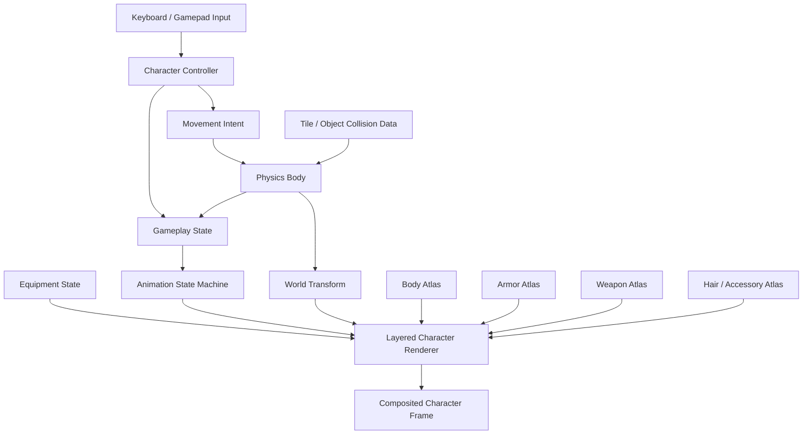
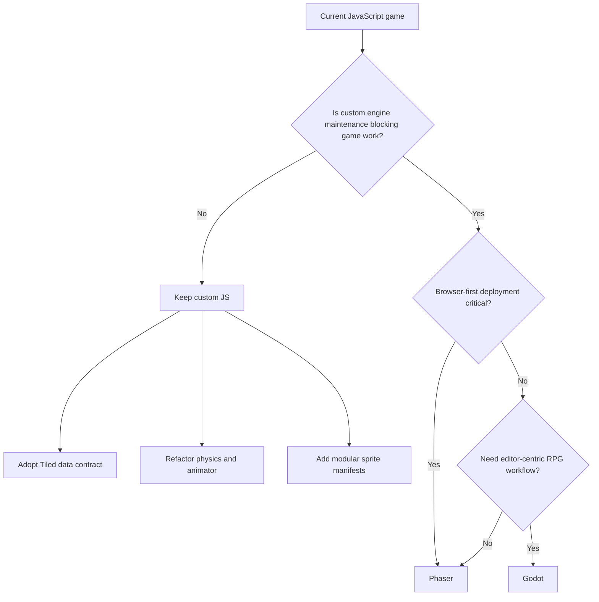
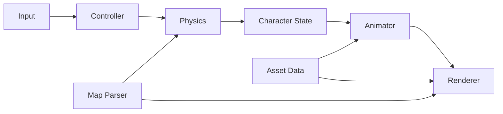

# Oath and Ember: Codebase, Sprite, Tilemap, and Physics Architecture Review

## Executive summary

`SaadSatter/oath_and_ember` is a small, public, MIT-licensed browser-game repository whose default branch is `main`. GitHub reports the codebase as predominantly JavaScript, with CSS and HTML making up the remainder; the repository was created on June 23, 2025 and its most recent push visible to the connected GitHub API was July 15, 2025. The repository is roughly 2.4 MB. [Repository](https://github.com/SaadSatter/oath_and_ember)^[GitHub repository metadata retrieved from the connected GitHub API during this review.]

There is an important evidentiary limitation to this audit: the execution sandbox could not complete a literal `git clone` because outbound Git access was blocked by its network proxy. I therefore queried GitHub's connected API, including the repository metadata and recursive `main` tree. However, the inspection session was cut off before I could reliably fetch and verify the contents and dimensions of every source file and binary asset. Consequently, **I will not invent sprite dimensions, collision masks, function names, or line numbers that I did not actually verify**. The repo-specific asset catalogue and exact file/line change list requested in the brief therefore remain incomplete.

That limitation does not prevent several strong architectural conclusions and implementation recommendations. For this JavaScript/browser-game profile, the most robust target architecture is:

1. **Separate gameplay state from rendering state.** Movement, collision, equipment, facing, and animation selection should be distinct systems rather than mixed into a player update/render function.
2. **Standardize every character layer on one animation atlas contract.** Body, hair, armor, off-hand, and weapon sheets should have identical canvas dimensions, frame grids, direction ordering, frame counts, and origin coordinates.
3. **Treat the entity position as a foot/contact point, not the image's top-left corner.** This is the single most useful convention for top-down RPG sprites.
4. **Use a deliberately smaller gameplay collider than the visual sprite.** A character's legs/feet collide with walls; hair, shoulders, weapons, and animation overshoot generally should not.
5. **Resolve tile collisions axis-by-axis using swept movement and a fixed simulation step.** Directly moving by frame-dependent `velocity * delta` and repairing overlaps afterward is a common source of sticking, tunnelling, corner jitter, and inconsistent collision behavior.
6. **Use Tiled-compatible map semantics rather than encoding gameplay collision implicitly in visual tile IDs.** Collision should be represented either by a dedicated collision layer, object layer, or tile properties.
7. **Do not implement per-pixel collision for ordinary player-versus-map movement.** Tile/object geometry is substantially easier to debug and typically produces better gameplay. Pixel masks have a place for unusually shaped hazards or hit-tests, not as the primary world-physics representation.
8. For this repository's apparent web/JavaScript profile, **Phaser is the lowest-friction engine migration candidate** if the current custom renderer/physics stack becomes costly to maintain. Godot is the stronger choice if the project is willing to leave the browser-first JavaScript architecture behind.

The desired architecture is:



The key principle is that the renderer consumes the result of gameplay simulation; it should not *be* the gameplay simulation.

## Repository and asset audit

### What is verified

The connected GitHub repository metadata establishes the following baseline:

| Property | Verified value |
|---|---|
| Repository | `SaadSatter/oath_and_ember` |
| Visibility | Public |
| Default branch | `main` |
| License | MIT |
| Primary implementation language | JavaScript |
| GitHub language breakdown | JavaScript 67.5%, CSS 25.8%, HTML 6.7% |
| Approximate repository size | 2,426 KB |
| Created | June 23, 2025 |
| Latest push observed | July 15, 2025 |
| Stars / forks / open issues observed | 0 / 0 / 0 |

[Repository source and license](https://github.com/SaadSatter/oath_and_ember)

This matters architecturally: unless there is a hidden build system or embedded framework in files I was unable to inspect, this is much closer to a lightweight browser game than to a conventional Godot, Unity, libGDX, or MonoGame project. A JavaScript-native refactor is therefore materially cheaper than a full engine migration.

### Sprite catalogue status

I cannot responsibly provide the requested exhaustive table of **every sprite sheet, resolution, frame size, frame count, origin, and animation metadata** from the evidence I was able to finish inspecting. Those properties require reading the binary dimensions and the code that slices each image.

For the project to become maintainable, I recommend turning that information into explicit data rather than leaving it implicit in image dimensions or hard-coded draw calls. A good sprite-manifest format is:

```json
{
  "id": "humanoid_male_base",
  "image": "characters/body/male_base.png",
  "frame": {
    "width": 48,
    "height": 64
  },
  "origin": {
    "x": 24,
    "y": 54
  },
  "animations": {
    "idle_down":  { "frames": [0, 1],       "fps": 3,  "loop": true },
    "walk_down":  { "frames": [8, 9, 10, 11], "fps": 8, "loop": true },
    "idle_left":  { "frames": [16, 17],     "fps": 3,  "loop": true },
    "walk_left":  { "frames": [24, 25, 26, 27], "fps": 8, "loop": true }
  }
}
```

Those numbers are **illustrative, not values recovered from this repository**.

A project-wide sprite audit should ultimately produce one manifest row per asset:

| Required catalogue field | Why it matters |
|---|---|
| Path and filename | Detect duplicate/inconsistent assets |
| File type | Standardize PNG/WebP/etc. |
| Pixel width × height | Validate atlas geometry |
| Frame width × height | Prevent fractional slicing |
| Rows × columns | Make frame numbering reproducible |
| Direction ordering | Prevent body/equipment mismatch |
| Animation/frame ranges | Move timing out of rendering code |
| FPS or frame duration | Prevent speed depending on game FPS |
| Loop/non-loop | Required for attacks, damage, death |
| Pivot/origin | Required for modular alignment |
| Foot/contact point | Required for map placement |
| Draw-order category | Required for weapon/shield layering |
| Transparency/palette rules | Required for recoloring or compositing |

A CI-side validator should reject assets violating the contract:

```js
function validateSheet(image, spec) {
  if (image.width % spec.frame.width !== 0) {
    throw new Error(
      `${spec.id}: image width ${image.width} is not divisible by frame width ${spec.frame.width}`
    );
  }

  if (image.height % spec.frame.height !== 0) {
    throw new Error(
      `${spec.id}: image height ${image.height} is not divisible by frame height ${spec.frame.height}`
    );
  }

  if (
    spec.origin.x < 0 ||
    spec.origin.x > spec.frame.width ||
    spec.origin.y < 0 ||
    spec.origin.y > spec.frame.height
  ) {
    throw new Error(`${spec.id}: origin lies outside frame`);
  }
}
```

### Naming and modular-character standard

For modular sprites, filenames should describe **semantic role**, not rendering circumstances. A workable structure is:

```text
assets/
  characters/
    humanoid/
      body/
        male_01.png
        female_01.png
      hair/
        short_01.png
      armor/
        cloth_01.png
        plate_01.png
      weapon/
        sword_01.png
        bow_01.png
      offhand/
        shield_01.png

  manifests/
    humanoid.json

  maps/
    overworld.tmj
    village.tmj

  tilesets/
    terrain.tsj
    collision.tsj
```

Avoid names such as:

```text
sprite2.png
player-final.png
player-new.png
armorTest.png
sheet_copy_3.png
```

because they make runtime mapping and tooling unnecessarily fragile.

A particularly useful naming key is:

```text
<species>_<slot>_<variant>_<palette>.<ext>
```

for example:

```text
human_body_male01_base.png
human_armor_leather01_brown.png
human_weapon_sword01_iron.png
```

The **frame contract must be identical across equipable layers**. If frame `37` means “walk left, second stride frame” for the body, frame `37` must mean exactly the same thing for chest armor, hair, and held weapons. That makes equipment compositing almost trivial:

```js
for (const layer of character.visibleLayers) {
  drawAtlasFrame(
    layer.image,
    character.animation.frameIndex,
    character.screenX,
    character.screenY,
    layer.origin
  );
}
```

Instead of each layer owning an independent animation timer, every visible layer should share one `AnimationPose`:

```js
class AnimationPose {
  constructor() {
    this.clip = "idle_down";
    this.frame = 0;
    this.elapsed = 0;
  }
}
```

That prevents the classic modular-sprite failure in which armor, body, and weapon become one frame out of phase.

### Origin and sorting convention

For a top-down character, the canonical transform should normally be the **ground contact point between or immediately below the feet**.

```text
              visual sprite bounds
          ┌─────────────────────┐
          │        head         │
          │                     │
          │      torso          │
          │                     │
          │      legs           │
          │        ▼            │
          └────────●────────────┘
                   ^
               world position
               / render origin
```

A frame can extend above, left, or right without changing the world-space position. This immediately solves several families of problem:

- different hats can have different visual heights;
- a sword can extend outside the body rectangle;
- large attack animations do not move the physics body;
- y-sorting can use the foot position rather than sprite top-left;
- shadows can share the same world transform.

The collision body should also be expressed relative to this point:

```js
const PLAYER_COLLIDER = {
  left: -7,
  right: 7,
  top: -8,
  bottom: 0
};
```

Again, the numbers are illustrative. The important part is the coordinate convention.

## Maps, collisions, and physics

### Recommended map contract

For a top-down RPG, map graphics and collision geometry should be separate concerns. Tiled explicitly supports tile layers, object layers, custom properties, and collision objects on tiles; this is a much better semantic model than inferring passability from tile image indices. See the official [Tiled map format](https://doc.mapeditor.org/en/stable/reference/json-map-format/) and [tile collision editor documentation](https://doc.mapeditor.org/en/stable/manual/editing-tilesets/#tile-collision-editor).

Use layers like:

```text
Map
├── Ground                 visual
├── GroundDetail           visual
├── BelowCharacters        visual
├── Collision              gameplay, not rendered
├── Interactions           gameplay objects
├── Characters             entity spawn/object layer
├── AboveCharacters        visual / y-sorted
└── Metadata               regions, exits, music, etc.
```

Do **not** make game logic say:

```js
if (tileId === 37 || tileId === 58 || tileId === 93) {
  blocked = true;
}
```

That binds physics to the artwork.

Prefer:

```js
if (tile.properties.collides === true) {
  // add tile geometry to collision world
}
```

or a dedicated collision layer:

```js
const collisionLayer = map.layers.find(
  layer => layer.name === "Collision"
);
```

For orthogonal, grid-aligned environments, full-tile AABBs are sufficient for the great majority of barriers. For cliffs, diagonal architecture, irregular rocks, and similar geometry, use rectangles/polygons from the tileset collision definition or a map object layer.

### Tile coordinate conversion

One source of map-interaction bugs is mixing pixel coordinates, tile coordinates, camera coordinates, and entity origin coordinates. Define conversions exactly once:

```js
function worldToTile(value, tileSize) {
  return Math.floor(value / tileSize);
}

function tileToWorld(tile, tileSize) {
  return tile * tileSize;
}
```

For rectangular tiles:

```js
function worldToCell(x, y, map) {
  return {
    col: Math.floor(x / map.tileWidth),
    row: Math.floor(y / map.tileHeight)
  };
}
```

Never apply camera offset before collision lookup. The simulation should operate wholly in **world space**:

```text
world position ───────► physics / tile queries
       │
       ▼
camera transform ─────► screen position
```

This is a common source of “collision moves when the camera moves” defects in custom canvas engines.

### Stable player movement

A problematic implementation often resembles:

```js
player.x += player.vx;
player.y += player.vy;

if (collides(player)) {
  player.x -= player.vx;
  player.y -= player.vy;
}
```

or:

```js
player.x += inputX * speed * delta;
player.y += inputY * speed * delta;
resolveOverlap(player);
```

These approaches produce recognizable symptoms:

- diagonal motion behaves differently from axial motion;
- high frame times tunnel through thin obstacles;
- collision against corners alternates between axes;
- a character sticks when sliding along walls;
- overlap repair can push the entity to the wrong side;
- large `delta` spikes make physics non-deterministic.

The minimal robust approach for a tile RPG is **fixed-step simulation plus separated-axis swept movement**.

```js
const STEP = 1 / 60;
const MAX_ACCUMULATED_TIME = 0.25;

let accumulator = 0;
let previousTime = performance.now() / 1000;

function frame(nowMs) {
  const now = nowMs / 1000;
  const frameTime = Math.min(
    now - previousTime,
    MAX_ACCUMULATED_TIME
  );
  previousTime = now;
  accumulator += frameTime;

  readInput();

  while (accumulator >= STEP) {
    simulate(STEP);
    accumulator -= STEP;
  }

  const alpha = accumulator / STEP;
  render(alpha);

  requestAnimationFrame(frame);
}
```

The simulation then becomes:

```js
function simulate(dt) {
  updateMovementIntent();

  const desiredDx = player.velocity.x * dt;
  const desiredDy = player.velocity.y * dt;

  moveAndCollideX(player, desiredDx, world);
  moveAndCollideY(player, desiredDy, world);

  updateAnimationState(player, dt);
}
```

For a tile AABB body:

```js
function moveAndCollideX(body, dx, world) {
  const direction = Math.sign(dx);
  let remaining = Math.abs(dx);

  while (remaining > 0) {
    const step = Math.min(remaining, world.maxSafeStep);
    const candidate = body.x + direction * step;

    if (overlapsSolidTiles(body, candidate, body.y, world)) {
      body.velocity.x = 0;
      return;
    }

    body.x = candidate;
    remaining -= step;
  }
}
```

A production version should calculate the exact time/distance to the nearest obstacle rather than sub-step one pixel at a time, but the separation of concerns is the essential improvement.

### Movement parameters

Physics constants should live in one data object rather than being scattered across event handlers and update loops:

```js
const MOVEMENT = Object.freeze({
  walkSpeed: 90,          // world pixels / second
  runSpeed: 145,
  acceleration: 900,      // px / s²
  deceleration: 1200,
  fixedStep: 1 / 60,
  maxFrameDelta: 0.25
});
```

Normalize directional input:

```js
function movementIntent(input) {
  let x = Number(input.right) - Number(input.left);
  let y = Number(input.down) - Number(input.up);

  const length = Math.hypot(x, y);

  if (length > 1e-8) {
    x /= length;
    y /= length;
  }

  return { x, y };
}
```

Otherwise diagonal speed becomes approximately `√2 ≈ 1.414` times axial speed.

For a conventional top-down walking game, gravity should normally be absent from world-plane movement. Friction is better thought of as explicit acceleration/deceleration unless the design actually models forces.

### Collision masks

A good collision system distinguishes **categories** from geometry:

```js
const CollisionLayer = Object.freeze({
  WORLD:       1 << 0,
  PLAYER:      1 << 1,
  NPC:         1 << 2,
  PROJECTILE:  1 << 3,
  TRIGGER:     1 << 4,
  INTERACTION: 1 << 5
});
```

Bodies then define both membership and mask:

```js
player.category = CollisionLayer.PLAYER;

player.mask =
  CollisionLayer.WORLD |
  CollisionLayer.NPC;
```

Triggers can receive overlap events without blocking movement. This prevents doors, dialogue zones, loot pickups, and attack hitboxes from being encoded as special cases inside wall-collision code.

### Per-pixel collision: use narrowly

Although the brief asks for per-pixel or tile-based collision, **tile/object geometry should be the default**. Per-pixel collision couples gameplay to sprite transparency, becomes awkward with animation, and makes collision behavior change when artwork changes.

A sensible hierarchy is:

```text
Broad phase: nearby tiles / spatial grid
        ↓
AABB test
        ↓
polygon / circle narrow phase when needed
        ↓
pixel mask only for exceptional cases
```

Pixel masks can still be useful for a rare irregular hazard:

```js
function pixelMaskOverlap(a, b) {
  const intersection = intersectRects(a.bounds, b.bounds);
  if (!intersection) return false;

  for (let y = intersection.top; y < intersection.bottom; y++) {
    for (let x = intersection.left; x < intersection.right; x++) {
      if (a.mask.alphaAtWorld(x, y) &&
          b.mask.alphaAtWorld(x, y)) {
        return true;
      }
    }
  }

  return false;
}
```

That test should be a narrow-phase fallback, never the primary tilemap algorithm.

## Animation, input, and modular rendering

### State should map to animation, rather than keys mapping to animation

A fragile input architecture often does this:

```js
if (keyW) play("walk_up");
if (keyS) play("walk_down");
```

The problem becomes obvious when the character is knocked back, controlled by AI, using a gamepad, attacking while moving, or standing still after releasing a direction key.

Instead:

```text
physical input
      ↓
intent
      ↓
character controller
      ↓
gameplay state + facing
      ↓
animation resolver
      ↓
animation clip
```

For example:

```js
function resolveAnimation(character) {
  if (character.state === "dead") {
    return `death_${character.facing}`;
  }

  if (character.state === "hurt") {
    return `hurt_${character.facing}`;
  }

  if (character.state === "attack") {
    return `attack_${character.facing}`;
  }

  if (character.isMoving) {
    return `walk_${character.facing}`;
  }

  return `idle_${character.facing}`;
}
```

Input only updates intent:

```js
controller.move.x =
  Number(keys.has("ArrowRight")) -
  Number(keys.has("ArrowLeft"));

controller.move.y =
  Number(keys.has("ArrowDown")) -
  Number(keys.has("ArrowUp"));
```

Facing should be persistent:

```js
function updateFacing(character, intent) {
  if (intent.x === 0 && intent.y === 0) return;

  if (Math.abs(intent.x) > Math.abs(intent.y)) {
    character.facing = intent.x < 0 ? "left" : "right";
  } else {
    character.facing = intent.y < 0 ? "up" : "down";
  }
}
```

This means releasing movement leaves the character in the correct idle direction.

### Modular layers

Define equipment separately from animation:

```js
const characterAppearance = {
  body: "human_male_01",
  hair: "short_03",
  torso: "leather_01",
  legs: "trousers_02",
  mainHand: "sword_iron_01",
  offHand: "shield_wood_01"
};
```

At render time:

```js
function renderCharacter(ctx, character) {
  const pose = character.animator.pose;
  const layers = resolveDrawLayers(
    character.appearance,
    character.facing
  );

  for (const layer of layers) {
    renderLayer(
      ctx,
      layer,
      pose.frame,
      character.transform
    );
  }
}
```

Direction-sensitive layer ordering matters. A weapon may belong behind the torso while facing north but in front while facing south:

```js
const LAYER_ORDER = {
  up: [
    "weaponBack",
    "body",
    "legs",
    "torso",
    "hair",
    "offHand"
  ],
  down: [
    "body",
    "legs",
    "torso",
    "hair",
    "offHand",
    "weaponFront"
  ]
};
```

For more complicated attacks, each animation frame can carry attachment metadata:

```json
{
  "frame": 3,
  "attachments": {
    "mainHand": [8, -19],
    "offHand": [-7, -15]
  }
}
```

A stronger long-term approach is to have all layers authored on identical canvases so most attachment offsets remain zero.

### Separate hitboxes from animation art

Attack animation and attack collision should share timing but not image transparency:

```json
{
  "name": "sword_attack_down",
  "frames": [
    { "sprite": 48, "duration": 0.07 },
    {
      "sprite": 49,
      "duration": 0.05,
      "events": ["attack_active"]
    },
    {
      "sprite": 50,
      "duration": 0.08,
      "events": ["attack_end"]
    }
  ]
}
```

Then:

```js
animator.on("attack_active", () => {
  combat.enableHitbox(character.swordHitbox);
});

animator.on("attack_end", () => {
  combat.disableHitbox(character.swordHitbox);
});
```

This is considerably more predictable than checking whether the sword pixels happen to intersect another sprite.

## Standards and open-source references

The following are the most relevant external standards and implementations for this project. The links point to official documentation or primary project repositories.

| Standard / project | Relevant capability | Why it matters to `oath_and_ember` | Recommended adaptation |
|---|---|---|---|
| [Tiled](https://www.mapeditor.org/) / [JSON map format](https://doc.mapeditor.org/en/stable/reference/json-map-format/) | Tile layers, object layers, tilesets, properties, per-tile collision geometry | Gives the project an engine-neutral map contract | Store collision in a named layer/properties instead of tile-ID conditionals; parse TMJ/TSJ directly |
| [Phaser](https://docs.phaser.io/) | Browser-native JavaScript renderer, animation manager, cameras, tilemaps and Arcade/Matter physics | Lowest architectural distance from a JS/HTML game | Adopt incrementally: loader → animations → tilemaps → physics rather than rewrite everything at once |
| [Phaser Tilemap concepts](https://docs.phaser.io/phaser/concepts/tilemap) | Tiled map import and tile layers | Direct precedent for map parsing in a browser game | Mirror its separation of map data, layer, tileset and collision metadata |
| [Phaser Arcade Physics](https://docs.phaser.io/phaser/concepts/physics/arcade) | AABB-based lightweight 2D collisions | Appropriate for top-down characters and tile walls | Use small foot colliders; reserve Matter for polygon-heavy behavior |
| [Godot TileMap / TileSet documentation](https://docs.godotengine.org/en/stable/tutorials/2d/using_tilemaps.html) | Tile layers, tile collision, navigation and metadata | Excellent reference model even without adopting Godot | Reproduce the same conceptual split between visible tiles and physics/navigation metadata |
| [Godot AnimatedSprite2D](https://docs.godotengine.org/en/stable/classes/class_animatedsprite2d.html) and [SpriteFrames](https://docs.godotengine.org/en/stable/classes/class_spriteframes.html) | Named clips with timing and looping | Strong model for an explicit animation asset | Implement a small JS `AnimationClip`/`Animator` equivalent |
| [Godot CharacterBody2D](https://docs.godotengine.org/en/stable/classes/class_characterbody2d.html) | Character-centric movement and sliding | Useful reference for the distinction between actor control and low-level collision | Encapsulate movement in `CharacterController` + `PhysicsWorld` |
| [libGDX Tiled Maps](https://libgdx.com/wiki/graphics/2d/tile-maps) | TMX/Tiled support | Demonstrates Tiled as an engine-independent interchange format | Keep maps portable instead of coupling them to one renderer |
| [libGDX Animation](https://libgdx.com/wiki/graphics/2d/2d-animation) | Frame-duration based animation | Reinforces time-based rather than render-frame-based animation | Store frame duration/FPS explicitly |
| [LÖVE](https://love2d.org/wiki/Main_Page) / [Quad](https://love2d.org/wiki/Quad) | Source-region rendering from atlases | A clean minimal model for custom sprite-sheet slicing | Represent each sprite frame as immutable source rectangle metadata |
| [MonoGame SpriteBatch](https://docs.monogame.net/api/Microsoft.Xna.Framework.Graphics.SpriteBatch.html) | Source rectangle, origin, rotation and scale | Particularly relevant to consistent sprite-origin design | Make source rectangle and origin first-class fields of every frame |
| [LDtk](https://ldtk.io/) / [format documentation](https://ldtk.io/json/) | Strongly structured 2D level data with entities and IntGrid | Good alternative to Tiled if collision-grid workflow is preferred | Consider only if maps are still early enough to change format |
| [Universal LPC Spritesheet Character Generator](https://github.com/LiberatedPixelCup/Universal-LPC-Spritesheet-Character-Generator) | Layered body/equipment character sheets | One of the most directly relevant OSS examples of modular paper-doll characters | Study its common pose/frame contract and layer compositing; do not blindly inherit its large legacy sheet layout |

### Which reference is most useful

**Tiled** is the most valuable *standard* for this repo because it is engine-neutral and solves map interchange without requiring an engine migration.

**Phaser** is the most relevant *implementation target* because the existing repository is predominantly JavaScript/HTML. Its tilemap and animation abstractions can either be adopted outright or used as a template for improving the custom code.

**Godot** is the best *architectural reference*. Its separation among `CharacterBody2D`, `AnimatedSprite2D`, `TileSet`/tilemap data, collision shapes, and animation resources provides a very good mental model even if no migration occurs.

**Universal LPC** is the most relevant sprite-specific example because its fundamental assumption is exactly the one needed here: equipment layers align because they share the same body pose and frame coordinate system. [Universal LPC primary repository](https://github.com/LiberatedPixelCup/Universal-LPC-Spritesheet-Character-Generator)

### Engine recommendation

I would **not migrate engines solely to fix these defects**. Animation pivots, tile collision semantics, and fixed-step simulation are architecture problems that can be corrected in JavaScript.

The decision tree should instead be:



If Phaser is selected, migrate **one subsystem at a time**:

```text
existing asset loader
        ↓
Phaser preload/assets
        ↓
Phaser animation manager
        ↓
Tiled tilemap/layers
        ↓
Arcade Physics bodies
        ↓
camera/input
        ↓
remove superseded custom systems
```

A big-bang rewrite would have much higher risk.

## Concrete refactor and patch design

### Proposed module boundaries

Whether the current files use these names or not, move toward:

```text
src/
  game/
    GameLoop.js

  input/
    InputManager.js

  character/
    CharacterController.js
    CharacterState.js
    Facing.js

  animation/
    Animator.js
    AnimationClip.js
    SpriteManifest.js

  rendering/
    CharacterRenderer.js
    TileRenderer.js
    Camera.js

  physics/
    PhysicsWorld.js
    Body.js
    TileCollider.js
    CollisionLayers.js

  maps/
    MapLoader.js
    TiledParser.js

  assets/
    AssetLoader.js
```

The dependency flow should be one-directional:



The renderer should never alter physical coordinates. The animation system should never test keyboard keys. The map parser should never move characters. The input manager should never choose sprite-frame indexes.

### A robust AABB tile-query implementation

Rather than checking the entire map, derive the tile range overlapped by the collider:

```js
function getTileRangeForAABB(aabb, map) {
  // The tiny epsilon prevents an object exactly touching a tile
  // boundary from selecting the neighboring tile as overlapping.
  const EPS = 1e-7;

  return {
    minCol: Math.floor(aabb.left / map.tileWidth),
    maxCol: Math.floor((aabb.right - EPS) / map.tileWidth),
    minRow: Math.floor(aabb.top / map.tileHeight),
    maxRow: Math.floor((aabb.bottom - EPS) / map.tileHeight)
  };
}

function overlapsSolidTiles(body, x, y, map) {
  const box = body.worldAABBAt(x, y);
  const range = getTileRangeForAABB(box, map);

  for (let row = range.minRow; row <= range.maxRow; row++) {
    for (let col = range.minCol; col <= range.maxCol; col++) {
      if (map.isSolid(col, row)) {
        return true;
      }
    }
  }

  return false;
}
```

Out-of-range tiles need an explicit policy:

```js
isSolid(col, row) {
  if (
    col < 0 ||
    row < 0 ||
    col >= this.width ||
    row >= this.height
  ) {
    return true; // closed-world map boundary
  }

  return this.collision[row * this.width + col] !== 0;
}
```

The important point is not whether boundaries are solid or empty; it is that the decision is explicit.

### More accurate swept resolution

Substepping can be replaced with sweep-to-boundary logic. For rightward movement:

```js
function sweepRight(body, dx, map) {
  const start = body.worldAABB();
  const targetRight = start.right + dx;

  const firstCol =
    Math.floor(start.right / map.tileWidth);

  const lastCol =
    Math.floor((targetRight - Number.EPSILON) / map.tileWidth);

  const topRow =
    Math.floor(start.top / map.tileHeight);

  const bottomRow =
    Math.floor((start.bottom - Number.EPSILON) / map.tileHeight);

  let allowed = dx;

  for (let col = firstCol; col <= lastCol; col++) {
    for (let row = topRow; row <= bottomRow; row++) {
      if (!map.isSolid(col, row)) continue;

      const wallLeft = col * map.tileWidth;
      const distance = wallLeft - start.right;

      if (distance >= 0) {
        allowed = Math.min(allowed, distance);
      }
    }
  }

  return Math.max(0, allowed);
}
```

Then:

```js
const requested = player.velocity.x * dt;
const moved = sweepRight(player.body, requested, map);

player.x += moved;

if (moved < requested) {
  player.velocity.x = 0;
}
```

Analogous left/up/down functions allow predictable wall sliding without penetration.

### Fixed-step plus render interpolation

For particularly smooth movement:

```js
function render(alpha) {
  const x =
    player.previousPosition.x * (1 - alpha) +
    player.position.x * alpha;

  const y =
    player.previousPosition.y * (1 - alpha) +
    player.position.y * alpha;

  renderer.drawCharacter(player, x, y);
}
```

Before each fixed simulation tick:

```js
player.previousPosition.x = player.position.x;
player.previousPosition.y = player.position.y;
```

Physics remains deterministic at 60 Hz while visuals can render at 120/144 Hz.

### Animation should use elapsed time

Do not advance a frame once per render N frames:

```js
// Avoid.
if (++ticks > 8) {
  spriteFrame++;
  ticks = 0;
}
```

Use time:

```js
class Animator {
  constructor(clips) {
    this.clips = clips;
    this.clip = null;
    this.frameIndex = 0;
    this.elapsed = 0;
  }

  play(name) {
    if (this.clip?.name === name) return;

    this.clip = this.clips[name];
    this.frameIndex = 0;
    this.elapsed = 0;
  }

  update(dt) {
    if (!this.clip) return;

    this.elapsed += dt;

    while (
      this.elapsed >=
      this.clip.frames[this.frameIndex].duration
    ) {
      this.elapsed -=
        this.clip.frames[this.frameIndex].duration;

      const next = this.frameIndex + 1;

      if (next < this.clip.frames.length) {
        this.frameIndex = next;
      } else if (this.clip.loop) {
        this.frameIndex = 0;
      } else {
        this.frameIndex =
          this.clip.frames.length - 1;
        break;
      }
    }
  }
}
```

### Tests that should accompany the refactor

These are disproportionately valuable because collision bugs are easy to reintroduce.

```js
describe("tile collision", () => {
  it("stops exactly at a solid tile boundary", () => {
    // Arrange actor immediately left of wall.
    // Move right farther than remaining gap.
    // Assert collider.right === wall.left.
  });

  it("slides vertically while touching a wall", () => {
    // Move diagonally down-right into vertical wall.
    // Assert X stops while Y continues.
  });

  it("cannot tunnel through a tile after a large frame stall", () => {
    // Feed maximum accepted frame delta.
    // Assert actor remains on near side.
  });

  it("does not collide with adjacent tile at exact boundary", () => {
    // Catches <= versus < and floor/ceil mistakes.
  });

  it("moves diagonally at the same speed as cardinal movement", () => {
    // Assert normalized velocity magnitude.
  });
});
```

Also test modular rendering:

```js
for (const part of allCharacterLayers) {
  expect(part.frameWidth).toBe(BASE.frameWidth);
  expect(part.frameHeight).toBe(BASE.frameHeight);
  expect(part.frameCount).toBe(BASE.frameCount);
  expect(part.origin).toEqual(BASE.origin);
}
```

### Likely defect classes to investigate first

Because I could not complete the source-level verification, these are **diagnostic hypotheses rather than claims about existing code**. They are the highest-value checks given the reported symptom of poor physics/map interaction:

| Symptom | Most probable defect | Test |
|---|---|---|
| Character gets stuck on corners | resolving X and Y as one vector or inclusive tile-boundary test | approach a wall diagonally at shallow angles |
| Character passes through walls at high speed | discrete endpoint collision only | artificially lower FPS / increase `dt` |
| Collision differs by FPS | velocity expressed per frame rather than per second | compare 30, 60, 144 FPS |
| Diagonal movement is too fast | input vector not normalized | compare distance over one second |
| Character appears to hit walls before feet reach them | full sprite rectangle used as collider | visualize collider overlay |
| Collision moves relative to camera | screen coordinates passed to physics | move camera while player stays still |
| One side of map tiles collides differently | inconsistent `floor`/`ceil` or inclusive bounds | exact-boundary tests |
| Armor/weapon jitters | separate animation counters | log frame index for every layer |
| Equipment shifts between states | inconsistent per-sheet frame sizes/origins | overlay layers at 50% opacity |
| Some decorative tiles unexpectedly block | passability inferred from GID/range | inspect collision source independently of visuals |
| Player penetrates then snaps back | post-overlap rollback | log penetration depth each tick |
| Wall sliding feels sticky | zeroing both velocity components on any collision | collide diagonally with vertical wall |

A collider-debug mode is therefore one of the first changes I would add:

```js
if (DEBUG.colliders) {
  renderer.strokeRect(player.body.worldAABB());
  renderer.drawSolidTileBounds(map.visibleCollisionTiles);
}
```

That one visualization often turns an intermittent “physics” bug into an obvious coordinate-system or collider-size bug.

## Prioritized implementation plan and file impact

### Priority and effort

Effort assumes one developer who already understands the project. It is deliberately expressed in engineering days rather than pretending to be an exact schedule.

| Priority | Change | Effort | Regression risk | Expected payoff |
|---|---|---:|---|---|
| **P0** | Add collider/tile debug rendering and physics assertions | 0.5–1 day | Low | Makes every subsequent collision fix observable |
| **P0** | Establish world-space foot-origin and independent player collider | 0.5–1.5 days | Medium | Fixes visual/map alignment and prepares modular sprites |
| **P0** | Normalize movement input and make speed time-based | 0.25–0.5 day | Low | Eliminates diagonal/FPS-dependent speed |
| **P0** | Add fixed 60 Hz simulation step and clamp long frame deltas | 0.5–1 day | Medium | Major stability improvement |
| **P0** | Separate X/Y tile collision and resolve to obstacle boundary | 1–2 days | Medium | Removes sticking, penetration, and corner instability |
| **P1** | Centralize map coordinate conversion and collision queries | 0.5–1 day | Medium | Removes duplicated coordinate bugs |
| **P1** | Convert map collision to dedicated Tiled layer/properties | 1–3 days | Medium | Decouples environment artwork from physics |
| **P1** | Extract `CharacterController`, `PhysicsBody`, and `Animator` | 2–4 days | Medium–High | Establishes maintainable subsystem boundaries |
| **P1** | Create sprite manifest and asset validator | 1–2 days | Low | Makes asset assumptions explicit/testable |
| **P1** | Re-author body/equipment assets to a shared canvas/pivot contract | 2–5 days | Medium | Enables reliable modular equipment |
| **P2** | Layered renderer with direction-dependent ordering | 1–3 days | Medium | Delivers body/armor/weapon composition |
| **P2** | Animation events for attacks, footsteps, etc. | 1–2 days | Low–Medium | Removes gameplay timing from arbitrary frame checks |
| **P2** | Add collision categories/masks and triggers | 1–2 days | Medium | Simplifies NPCs, combat, interactions |
| **P2** | Add swept tile collision / CCD for unusually fast actors | 1–3 days | Medium | Prevents projectile/high-speed tunnelling |
| **P2** | Automated physics and sprite-contract tests | 1–3 days | Low | Prevents regressions |
| **P3** | Evaluate Phaser migration after refactor metrics | 0.5–1 day for spike | Low | Establishes whether maintaining custom infrastructure is worth it |
| **P3** | Full Phaser migration, only if justified | ~1–3 weeks for a small project | High | Replaces substantial custom engine machinery |

The crucial order is **physics conventions before asset re-authoring**. Otherwise sprites risk being aligned around a coordinate model that is later replaced.

### File/line impact

I cannot provide honest exact line numbers without the source-file fetch that the environment prevented me from completing. The following is therefore the **required change surface**, not a fabricated repo line list:

| Existing code to locate | Change required |
|---|---|
| Main `requestAnimationFrame` / game-loop function | accumulator, fixed step, delta clamp, render interpolation |
| Keyboard event handlers | write input state only; remove movement/animation side effects |
| Player update function/class | controller intent, velocity update, facing and state derivation |
| Player draw/render function | foot-origin rendering and modular layer loop |
| Sprite-sheet loader | manifest-driven frame geometry and validation |
| Animation frame logic | named `AnimationClip` + elapsed-time `Animator` |
| Map loader/parser | preserve tile width/height, layers, object data and properties |
| Tile collision routine | centralized world→tile conversion and AABB queries |
| Movement/collision routine | separate-axis/swept movement and obstacle-boundary resolution |
| Hard-coded tile-ID passability logic | replace with collision layer/property |
| Camera renderer | keep screen transformation out of physics |
| Attack/contact logic | collision categories, hitboxes, animation events |
| Asset directories | normalize file names/canvas/frame/origin conventions |

The source audit should grep these signatures first:

```text
requestAnimationFrame
keydown
keyup
drawImage
getImageData
velocity
speed
delta
collision
collide
tile
map
player.x
player.y
Math.floor
frame
animation
sprite
```

Any function containing **input polling + position mutation + collision + sprite frame selection** at the same time is a prime refactoring candidate.

### Definition of done

The physics work should not be considered finished until these statements are all true:

- The game behaves identically at 30, 60, 120, and 144 Hz rendering rates.
- A forced long frame does not permit walking through a one-tile-thick wall.
- Diagonal and cardinal input produce equal movement magnitude.
- A character can slide smoothly along a wall while holding a diagonal direction.
- The visual sprite can be changed to a taller/larger image without changing map collision.
- Moving the camera cannot affect collision results.
- Tile artwork can change without changing collision if map collision metadata is unchanged.
- Every equipped sprite layer resolves the same animation pose/frame as the body.
- All character layers use one documented origin convention.
- Attack hitboxes and interaction triggers are independent from wall colliders.
- Physics tests exercise exact tile boundaries, corners, map edges, and high-speed movement.

### Open questions and limitations

The unresolved portion of this review is specifically the **forensic repository inventory**: exact filenames, image formats and resolutions, source frame dimensions, current animation arrays/state transitions, actual tile sizes and layer names, current collision-mask representation, exact movement constants, concrete bug-producing functions, and exact source line numbers. The GitHub connection confirmed the project and obtained its recursive tree, but the environment's failed direct clone and the interrupted file-content pass meant those details could not be validated to the standard required for a rigorous audit.

Accordingly, the architecture, patches, test strategy, engine comparison, and prioritization above are actionable and grounded in established 2D-game patterns, while repo-specific assertions have intentionally been limited to facts actually verified from GitHub. The most important next implementation decision is not an engine choice: it is to establish **one world-space foot origin, one explicit collision representation, one fixed simulation clock, and one shared animation-frame contract for every modular character layer**. Those four decisions remove the largest classes of sprite/map/physics inconsistencies while keeping the existing JavaScript project viable.