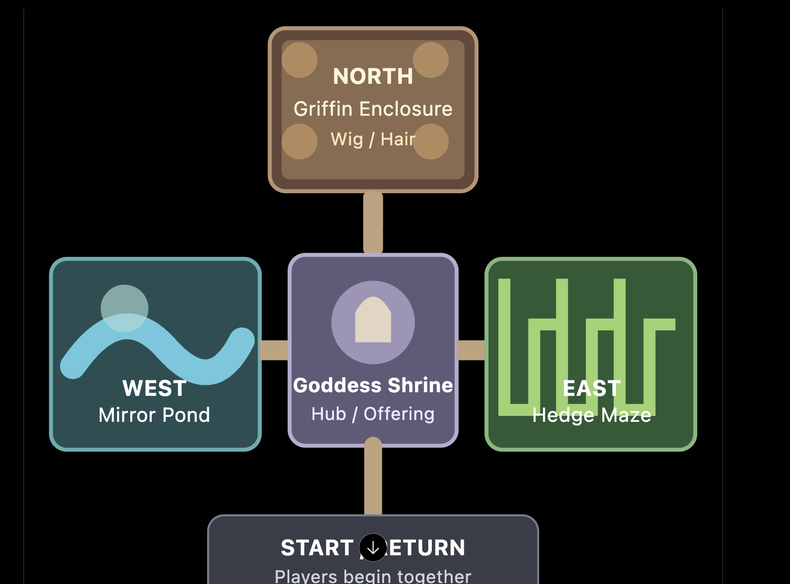
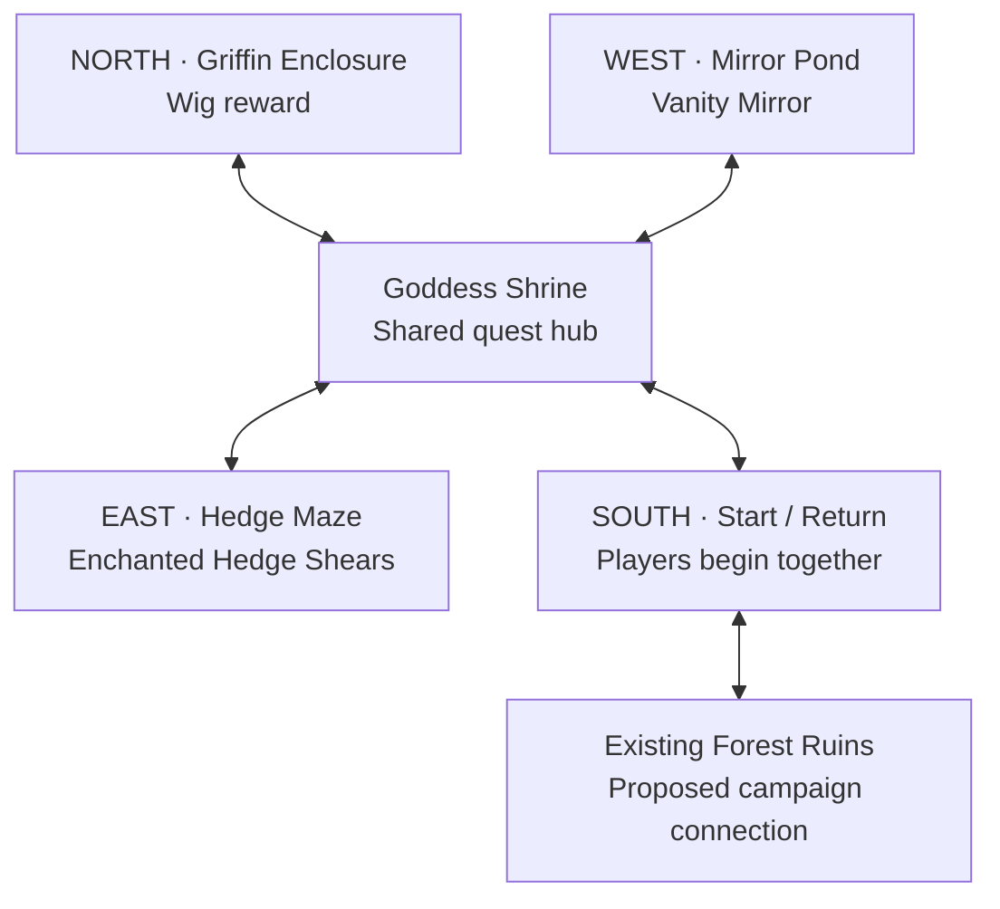

# The Bald Goddess — Phase 1 architecture and world plan

Status: all four map layouts approved October 14, 2026. The styled inventory was subsequently approved and its shared foundation is implemented and tested. The Hedge Maze is implemented; see `hedge-maze-implementation.md`. Other quest maps and independent scene simulation are not implemented yet.

This document interprets the attached quest brief as a feature specification. It does not change project operating rules. The user's explicit requirements take precedence: share the inventory between Sieg and Coco, reuse existing PixelLab assets when possible, keep skill points and the skill tree disabled, keep E as interaction for both characters, and keep Push on Sieg's 1/icon. The inventory foundation now exists; see `phase-2-inventory-design.md` for implementation and validation status. The capability audit below records the original pre-inventory inspection.

## 1. Verified current capabilities

| System | Actual current behavior | Quest implication |
|---|---|---|
| Sieg basic attack | Server-owned forward 120-degree arc, 85px range, 25 damage, captured attack facing; delayed directional contact | Preserve facing, contact timing and obstruction checks |
| Super Speed | Starting ability, 10 seconds, 5 seconds of recovery; doubles normal movement; restores normal speed during Slow Time | Can support timed maze mechanisms |
| Guard / Ward | Starting defense for each hero, held with K; reduces incoming damage | Preserve both |
| Push | Sieg-only `pushHeld`, key 1 or icon; server moves reviewed props and the persistent bridge boulder with collision checks | Useful for maze and pond machinery; E must not push |
| Heavy Break | Charge/release implementation exists, but `heavy` is not a starting skill and there is no normal purchase UI or point income | Do not require it to finish a quest puzzle. Keep the implementation intact. A reinforced-hedge shortcut can be optional if Heavy Break becomes available later |
| Fireball | Starting level one: 20 damage, 180px/s, 672px maximum range; directional projectile; upgraded tiers exist but are not starting abilities | Use normal fireball for ranged triggers; retain the supplied new projectile/impact art |
| Slow Time | Starting ability: 10 seconds at 0.2 movement speed, 20-second cooldown measured from activation; remaining recovery after the effect is about 10 seconds | Reusable for cooperation, but new environmental mechanisms need explicit time scaling |
| Flight | Starting ability: 20 seconds, 7-second recovery. Only tagged water/canyon blockers are bypassed; walls, trees, objects, grass restrictions and puzzle wards remain solid. Expiry over a gap restores a safe position. Map travel ends flight | Pond water must be explicitly classified. Flight can reach controls but cannot open an unearned chest |
| Black Hole | Starting ability: travels up to 192px / six 32px tiles; stops on solid geometry or an enemy. Four-second vortex, 96px / three-tile radius, 30 damage once per enemy, 10-second cooldown from cast. Pull respects solid collision and line of sight. Travel/pull slow during Slow Time | Supports enemy positioning. Boss resistance and enemy-operated switches do not exist yet and must be added explicitly |
| Telekinesis | A legacy skill definition remains. It is not a starting ability; the old E-based counterweight movement was removed when E and Push were separated | No current player-available Telekinesis interaction to design around |
| Blink | Deterministic K-burst code exists if `blink` is present, but it is not in Coco's starting abilities | Do not require it |
| Enemies | Mosslings, cinder wisps and sentinels; server-owned pursuit, attacks, windups, projectile damage and collision | Reuse approved monster sprites; authored patrol routes and the Griffin are new work |
| Puzzles | Shared puzzle flags, switches, timed hazards, heavy-object plates, moving targets, persistent boulder, authoritative resets | Reuse patterns; maze, mirrors, chest rewards and offerings are not implemented |
| Inventory / NPCs | No reusable gameplay inventory, chest reward system, item-use protocol, dialogue tree or quest framework found | Build one shared foundation rather than per-map panels |

Evidence: `packages/shared/src/{abilities,combat,movement,blackHole,pushables,bridgePuzzle,enemies}.ts`; `apps/server/src/{GameRoom,blackHoles,enemySimulation,app}.ts`; `apps/client/src/{main,entities/PlayerView,entities/ProjectileView}.ts`.

## 2. World connectivity — user layout reference

The user supplied the hub layout below after reviewing Phase 1. Use this arrangement as the reference: both players begin together in a southern Start / Return area, enter the central Goddess Shrine from the south, and reach the west pond, east maze and north Griffin enclosure through separate bidirectional paths. This records the layout direction; it does not imply approval of the remaining architecture or later implementation phases.

Proposed campaign attachment: an optional, bidirectional side path from Forest Ruins into the southern Start / Return area. Both players initially arrive together there, then enter the Shrine to the north. This preserves the existing Monster Clearing → Puzzle Map 2 → Forest Ruins sequence. The new quest does not gate the existing campaign. The exact attachment is a proposal, not an implemented route.

East, west and north are open from the hub immediately. The Griffin can be attempted first. Each player can explore and return independently, although cooperative mechanisms naturally require meeting up. Portals use E, validate range on the server, preserve local progress, and place the arriving player at a collision-safe destination entrance without transporting their partner. No party-wide scene resets or free healing on these local transitions.

## 3. High-level map concepts

These dimensions are provisional planning envelopes on the game's 32-world-pixel logical grid. They are not approved layouts or an instruction to rescale artwork. Exact locations, annotated routes and collision footprints will be proposed at the later map-specific checkpoints.

| Map | Proposed dimensions | Main routes and challenges | Reward / safety |
|---|---|---|---|
| Goddess Shrine | 40 × 32 tiles | Southern Start / Return path, western pond path, eastern maze path, northern enclosure; central statue plaza | Shared offering interaction; all branches remain open |
| Hedge Maze | 48 × 40 tiles | Looped hedge garden with well/ruin/colored-tree landmarks, connecting corridors and visible return shortcuts | Shears chest opens only after three cooperative challenges latch; retreat always possible |
| Mirror Pond | 48 × 40 tiles | Stone perimeter, water, landing islands and four reflection stations | Fourth torch raises the entire center platform, chest and connecting bridge |
| Griffin Enclosure | 40 × 36 tiles | Broad arena, visible entrance retreat lane, cover and reflection plinths, central combat space | Wig reward chest becomes available after defeat or a valid hair-cut resolution |

### Hedge Maze concept

Revised to match the latest annotated proposal. A more complex network of loops and dead ends leads through three mandatory trials:

1. Coco burns one visibly dry hedge with Fireball. Other hedge walls stay solid, including during Flight. The burned passage stays open.
2. A single large, harmless cow blocks the full forward corridor. Coco enters a side bay and casts Black Hole into its near flank to pull it sideways. The cow moves physically into the bay, opening the lane; no teleport or friendly damage. The planned position is within the existing six-tile projectile and three-tile pull ranges.
3. A fast monster carries the chest key by fleeing both heroes through navigable branches. Coco uses Slow Time while Sieg uses Super Speed and holds E within tagging reach to claim the key. Proposed tuning: runner 430 px/s, slowed to 86; boosted Sieg remains 190 px/s during Slow Time. It chooses escape routes based on both heroes, rather than following a repeating patrol. Runner resists Black Hole; ranged damage cannot claim the key.

Five encounter monsters are planned in addition to the existing key runner: before the burnable bush, one Mossling and one Cinder Wisp; before the cow, one Mossling, one Cinder Wisp and one Iron Sentinel. Use approved existing sprites. The Iron Sentinel uses its current starter sprite; its attacks and attack animations remain unimplemented and are not added by this planning revision. The cow remains a harmless, damage-immune puzzle animal.

The shared key opens the sole gate to the Enchanted Hedge Shears chest. Key consumption and gate opening must be atomic and idempotent. Burned hedge, parked cow and unlocked gate persist. Retry resets only the untagged runner, never an acquired key. These are proposed mechanics: the current Black Hole affects enemies only, so the cow needs an explicit friendly pullable body with collision-safe movement and damage immunity. Burnable hedges, runner capture and shared keys also require implementation.

### Mirror Pond concept

Revised to a four-station perimeter circuit. Two vertically moving spike heads sit along the east perimeter entrance; guardrails prevent walking around them. A solid wall blocks access from the southern perimeter. There is no southern return shortcut. The conditional center bridge crosses this barrier only after all torches light. Sieg uses Super Speed to pass the timed opening. Coco cannot pass the spike entrance, including in Flight. It is the sole entrance to the perimeter; pond-side wards prevent her landing there from the water. She uses a separate water culvert under the walkway to reach independent firing islands. Walls remain solid.

At each station Sieg uses Push to deploy a mirror shutter. At rest, it closes the firing opening and clears his walking lane. Deployment exposes the reflecting surface but obstructs his route. Coco fires across the pond, the reflected fireball travels through a narrow spell-only wall port to a protected torch, then Sieg restores the original orientation to continue. The four surface angles are −22.5°, 67.5°, 22.5° and 112.5°, yielding different incoming/outgoing directions. Each full shot remains within the current 21-tile Fireball range.

Torches sit behind walls and require a shot reflected by their paired mirror. Flight and direct shots cannot substitute. The fourth lit torch raises the entire center platform, its chest and connecting bridge together. Before that the center is water and cannot be used as a landing pad. Mirror resets clear Sieg’s route, but are not an additional platform activation condition. Torch progress persists; a spike failure returns Sieg to the entry dock. Landing islands and safe recovery prevent Flight expiry from stranding Coco.

This requires new authoritative mirror pivot states, collision-aware reflection preserving remaining projectile range, paired reflection identity, protected torch ignition, and spike timing. Narrow firing ports must block actors while allowing the authored reflected ray. Push rotates these mechanisms; E remains common interaction. No gameplay has been changed by these diagrams.

### Griffin concept

Latest layout supersedes the earlier arena plinth and add-control design. The northern third is water, with a small nest at the center of the north wall. The southern land arena contains four large ruined pillars. Coco can fly to the nest to deliver optional collected items; the approved sequence is mirror delivery to distract the Griffin, then shears delivery during distraction to cut its hair and award one wig without defeating it. Both shared tools remain owned. Never require unowned items or silently consume shared tools.

- The Griffin starts at the nest and flies over water to fire long-range eye lasers. An approaching Coco triggers a defensive return to the nest unless the Griffin is stunned.
- Coco uses Black Hole near shore to pull the Griffin physically onto land. This replaces the earlier boss pull resistance proposal. Keep its trajectory within the existing six-tile cast and three-tile pull ranges; allow the Griffin's flight over water while preserving obstacle collision.
- On land, Sieg remaining in one place too long triggers a very fast headbutt. The stationary threshold and telegraph require playtesting. Slow Time affects the Griffin's movement, headbutt and laser progression, giving Sieg time to dodge or move Coco while using Super Speed.
- A headbutt collision with one of the four pillars causes it to fall onto the Griffin, stunning it briefly. During the stun players can attack, or Coco can fly to the nest. Falling pillars must not damage or trap players without clear warning.
- Four pillars are destructible opportunities, not a finite mandatory resource: direct combat must remain possible after they fall. Retry restores pillars and transient boss state, preserving shared items. Prevent indefinite stun chaining.
- No optional items: players can defeat the Griffin using the combat loop. One authoritative wig reward follows encounter resolution. The approved nonlethal route is mirror distraction followed by automatic shears cutting at the nest. It grants the same single wig reward as combat, never an additional wig.

This is a planning proposal, not implemented boss behavior. Authoritative phases, shoreline pulling, laser collision and Slow Time, nest defense, stationary-player tracking, headbutt collision, pillar collapse and stun all require implementation and integration tests.

## 4. Shared inventory architecture

Ownership is settled: one inventory per room, shared by Coco and Sieg, including when they occupy different maps. There is no personal duplicate copy or item trading requirement. Selection, hovered descriptions and panel state are local to each client.

Proposed reusable modules:

- `packages/shared/src/items.ts`: stable item definitions, names, approved icon references, descriptions, categories, unique/stack rules and consume/retain policy. Future items extend the registry, not UI conditionals.
- Shared inventory/quest types: inventory revision, item counts, stable chest IDs and claimed state, target IDs, quest flags and per-scene mechanism state.
- Server inventory service: one validated item-use transaction; chest claim and reward grant are atomic. Room state owns both inventory and quest mutations.
- Client inventory panel: a reusable accessible grid/detail/use component, with local selection and no authority to award or consume items. Desktop/mobile wireframes belong to Phase 2.

Proposed items:

| Stable ID | Category | Retention and use |
|---|---|---|
| `enchanted_hedge_shears` | quest tool | Retained after valid hair cut; cannot cut outside a valid local target/window |
| `vanity_mirror` | quest tool | Retained after distraction and rejected offerings |
| `magnificent_griffin_wig` | quest offering | Unique; consumed only in the same successful transaction that completes the goddess quest |

Clients send intent such as `item:use { itemId, targetId, requestId }`; they never send inventory counts, damage, completion flags or a successful chest outcome. Exact protocol and models will be reviewed in Phase 2.

The server verifies session, living actor, scene, range, line of sight if relevant, target interaction rules, owned item, cooldown/window, and required partner conditions. Two simultaneous claims on one chest produce one reward. Replayed request IDs return the original outcome and never consume/grant twice. Concurrent mirror/shears use is valid because tools are retained; the unique wig can be consumed only once. Wrong goddess offerings return humorous feedback and consume nothing.

Chest interaction uses the same E semantics for both heroes. Inventory targets are selected locally, then the server resolves whether the selected item can be used on the nearby target. Keyboard and touch target selection will be specified with the wireframes.

Room snapshots synchronize inventory, chest states and quest completion; acknowledgments provide immediate feedback. A reconnect receives the current shared inventory, not a stale personal copy. Retain the existing in-memory room lifecycle; no persistence or scaling service. Server restarts or room disposal end the session, as they do now.

## 5. Necessary multiplayer architecture work

Current campaign travel uses `GameRoom.transition()` to relocate every player, swap one active enemy collection and clear shared effects. `Player.sceneId` and `relocate()` provide limited existing local travel for the house, but enemy AI, boss logic, Black Hole processing, slow-time scope, and several puzzle branches still rely on one `World.sceneId`. The existing saved-map cache supports revisiting, not simultaneous independent simulation.

Before enabling these new map portals:

1. Introduce server-owned per-scene runtime state for the quest hub and branches: enemies, boss state, chests, puzzle mechanisms, projectiles and effects. Maintain one room service and one deterministic tick loop.
2. Local portals relocate only the requesting player and clear only their stale movement intents. Preserve arrival epochs, validated input sequencing and safe collision placement. Keep the existing party-wide campaign transitions working.
3. Tick occupied quest scenes independently. Preserve solved flags in empty scenes; freeze/reset transient encounters according to explicit rules rather than silently clearing rewards. No cross-scene targeting, projectiles, damage or pull.
4. Scope Slow Time to the caster's current scene in the quest; moving to another branch must not slow unseen enemies or the partner there. Preserve the existing both-players-together behavior. This is a proposed scene-scope adjustment to approve, not a claim about current code.
5. Initially keep the existing room-wide disconnect pause, resuming from authoritative state after reconnect. Independent exploration means separate locations, not changing disconnect policy.
6. Snapshot the shared inventory/quest state and sufficient per-scene actor state; render each client according to its own player's scene. Avoid forcing the partner's camera or map to change.

This scene foundation is a dependency of the inventory target validation and map integration. Build/test it incrementally within approved implementation phases, not as an unapproved first-phase refactor.

## 6. Asset reuse plan

Confirmed available locally:

- User-supplied crying goddess shrine (`faa9d37e-f27c-4ed4-bbf9-59d1de1a4c61`) for the initial state.
- User-supplied joyful goddess shrine (`92051242-88a8-4cd4-9c1f-42f1354f3606`) for the completion state.
- The current maps' fall/base tree sprites, grass/stone/water terrain, approved ruins props, golden rock, bridge/gate/switch/plate assets, and current character/monster animation libraries.

The joyful sprite still depicts a bald head. A visible restored-hair state needs a separate wig prop/overlay or another approved existing variant; do not claim the current image already has restored hair. Use the supplied shrine sprites intact with reviewed ground footprints; their roof art is not a solid rectangle over the entire canvas. Top-down navigation/camera and collision remain independent of their decorative façade.

Hedges, rotatable mirrors, a Griffin, chests, shears and wig icons have not been positively identified in the loaded local asset paths; generic exported names are not evidence that they exist or do not exist in PixelLab. At each approved map stage, search the existing PixelLab library first, visually verify candidates, and record exact source IDs. Reuse approved artwork at established pixel density with nearest-neighbor rendering and stable anchors; no stretching, inpainting or silent replacement of existing assets. Generate only confirmed missing pieces after the corresponding layout is approved. No PixelLab tools have been used for this planning phase.

## 7. Main risks and verification gates

- **Scene isolation:** avoid attacks/pulls/mirror use or portal transitions affecting a player on another map. Integration tests must exercise two clients in different branches.
- **Shared-item races:** simultaneous chest opens, duplicate use packets, disconnect during reward or offering, and concurrent wig offers must yield one authoritative result.
- **Availability mismatches:** required solutions must use starting abilities; Heavy Break, Blink and legacy Telekinesis cannot silently become prerequisites.
- **Physics mismatches:** tag water separately from solid hedges/walls; verify flying, landing, prop pushing and enemy pulling against the same deterministic geometry.
- **Puzzle recovery:** missing players, expired Flight/Black Hole, creature death on a switch, and boss reset must not remove required tools or lock return paths. Latch completed puzzle sections.
- **Griffin balance:** verify a feasible no-item win, useful separate-item strategies and an easier two-item strategy without indefinite crowd control.
- **Visual completion:** obtain/approve visible hair artwork instead of merely swapping between two bald statues.

For implementation phases, run `npm run typecheck`, `npm test`, `npm run build` after gameplay/network changes. Add real two-client protocol tests for shared inventory, chest races, item use, independent travel, reconnection, and exactly-once offering completion. Existing approved art and source provenance remain preserved.

## Phase 1 approval checkpoint

Approve or revise this world plan, shared inventory approach, optional Forest Ruins attachment, and per-scene quest simulation proposal. Next deliverable after approval: desktop/mobile inventory wireframes and detailed item/state/interaction models, followed by the Phase 2 design approval checkpoint. This document does not approve implementation or PixelLab generation.

## Annotated map images requested after Phase 1

The user requested a Bridge-style plan image for every map. The four editable SVG and PNG proposals are indexed in [layouts/README.md](layouts/README.md). This advances visual planning only; it does not authorize gameplay implementation, inventory implementation, or final PixelLab generation.
