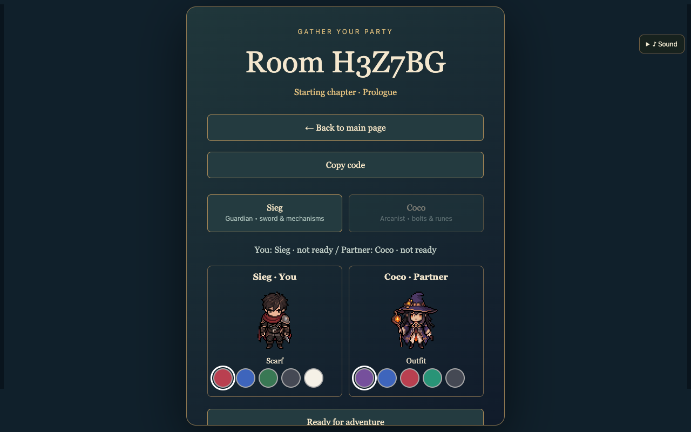
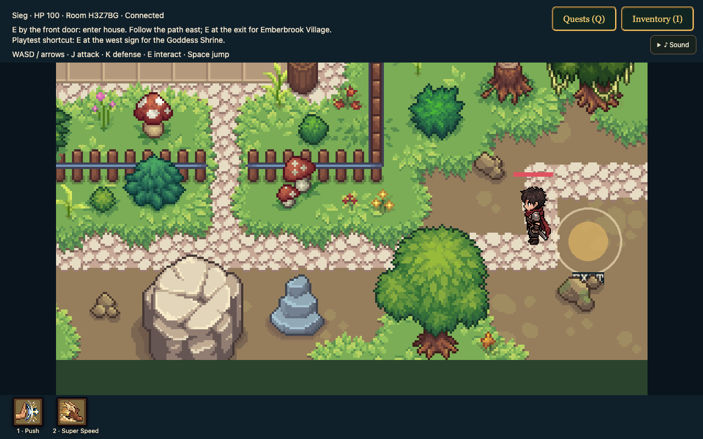
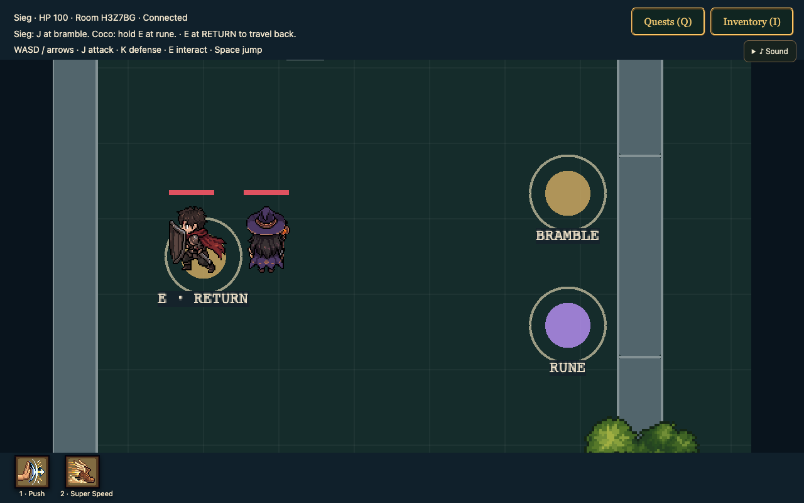
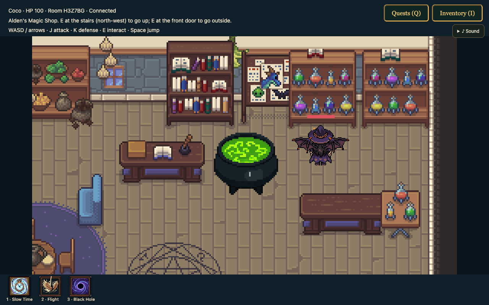
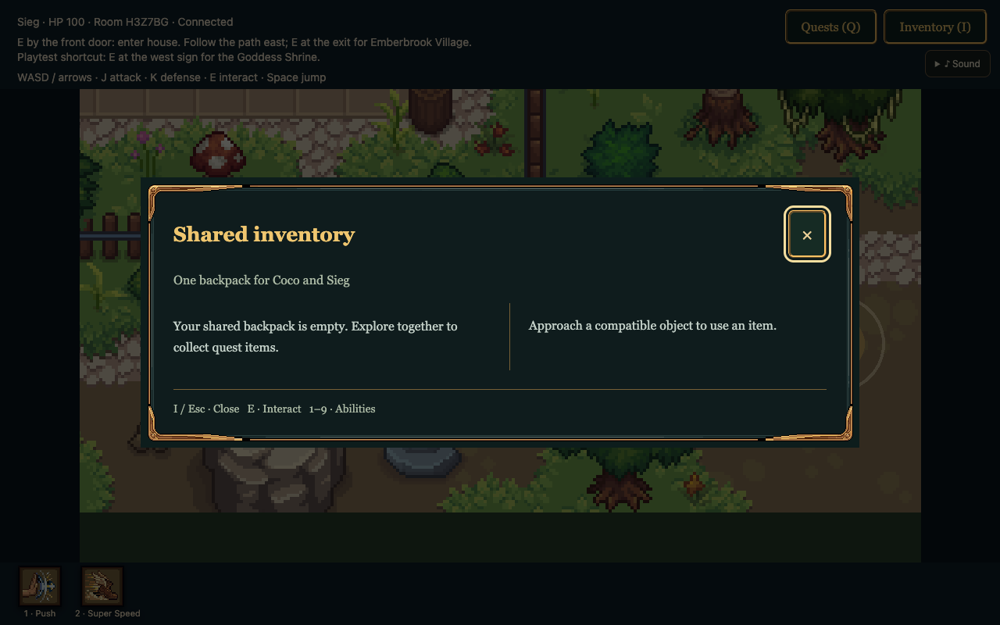
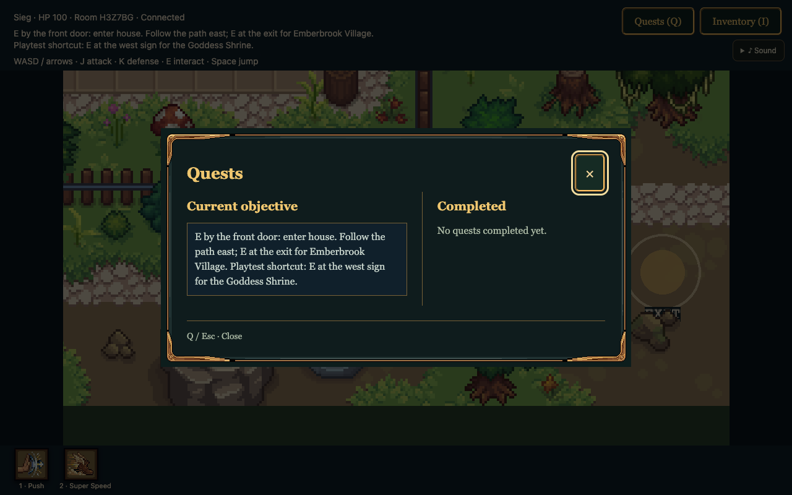

# Oath and Ember player manual

Mechanics reference • Current prototype • 22 October 2026

# Oath and Ember player manual

A reference to the controls, heroes and cooperative mechanics of Oath and Ember. Use it to learn how actions work and how to read the game, while discovering locations, puzzles and story events for yourself.

The room lobby shows hero selection, appearance choices and each player's ready status.

### Start a two player session

Open the game in two separate browser tabs or windows, or on two connected devices. One player creates a room and shares its six character code. The other enters that code to join. Choose different heroes: Sieg, the Guardian, and Coco, the Arcanist. Both players must select Ready for adventure before play begins.

### Choose your hero

Sieg handles sword combat and physical mechanisms. Coco uses ranged magic, time manipulation and flight. The lobby labels these heroes with their names; some game systems also call their roles Oath and Ember. Color swatches change appearance and let your partner see your selection.

### Find a reference quickly

Controls are on page 2. Movement and the interface are on page 3. Sieg and combat are on page 4. Coco's abilities are on page 5. Shared inventory and conversation are on page 6. Cooperation, quests and session behavior are on page 7.

## Controls at a glance

Click the game before using the keyboard. Number keys activate the abilities displayed for your selected hero. Dialogue and open panels temporarily take priority over gameplay controls.

| Action | Keyboard |
| --- | --- |
| Move | W A S D or arrow keys |
| Primary attack | J |
| Defense | Hold K |
| Interact or use nearby object | E |
| Shared inventory | I |
| Quest journal | Q |
| Close inventory or journal | Escape or the panel's own key |
| Jump in side view | Space, W or Up |
| Advance dialogue | E, Space or Enter |
| Select a story response | 1 to 3, or W/S then E or Enter |

| Hero ability | Main key | Alternate |
| --- | --- | --- |
| Sieg Push | Hold 1 | Ability button |
| Sieg Super Speed | 2 | Shift |
| Coco Slow Time | 1 | T |
| Coco Flight | 2 | F |
| Coco Black Hole | 3 | G |

### Mouse and touch

Click the inventory, quest, sound and ability buttons directly. On touch devices, use the directional controls and the Strike, Defense, Use and Jump buttons when displayed. Hold controls for sustained actions such as defense or pushing.

### Optional display tools

F3 opens networking diagnostics. F4 switches character rendering between sprites and geometric debug shapes. Neither changes the rules of play.

## Movement and the screen

Each player has an independent camera. Partners can explore different parts of a map, and some doors and stairs allow each hero to move between interiors independently.

Exploration view with status and objective text above the world and hero ability buttons below it.

### Read the interface

The top status line identifies your hero, current HP, room code and connection status. The text beneath it gives the current objective and local interaction hints. Health bars above characters and enemies show their remaining health. The ability icons at the bottom identify your available actions and show activity or recharge states.

### Movement and terrain

In overhead areas, use both movement axes to explore. Walls, furniture and solid obstacles block movement. Facing follows your movement and determines the direction of attacks and many interactions. Stand close to a door, sign, character or object before pressing E.

### Side view areas

Some later areas switch to platform movement with gravity. Move left and right, and jump with Space, W or Up while grounded. Platforms and gaps matter here; the jump control does not make ordinary overhead terrain traversable. Falling below a platform map returns the hero to that map's spawn.

### Sound settings

Open Sound near the upper right to mute effects or adjust their volume. These preferences are saved on the device.

## Sieg and close combat

Sieg uses a forward sword swing, physical pushing and bursts of speed. Position and facing matter: a sword swing reaches an area in front of him, rather than every enemy nearby.

Sieg using defense beside Coco in the Forest Ruins. Both heroes retain their own ability bars.

### Sword and defense

Press J to slash. A basic sword hit deals 25 damage, with about 0.45 seconds between attacks. Hold K to defend: a guarded hit deals one quarter of its normal damage. Sieg's starting movement skill also gives K a short forward burst when its separate two second cooldown is ready; holding defense can repeat that burst.

### Push and Super Speed

Stand near a movable object, face it and hold 1 to push. Solid walls and other obstacles can prevent movement. Some mechanisms respond to Push as a special interaction. Press 2 or Shift for Super Speed: movement doubles for 10 seconds, followed by 5 seconds of recharge. During Coco's Slow Time, this ability lets Sieg move at his ordinary unslowed speed.

### Heavy Break when available

If Heavy Break is enabled for your session, hold J to charge and release to strike. A release before about 0.47 seconds produces a normal slash; a longer hold produces a 40 damage heavy strike. Full charge takes about 1.1 seconds. Facing locks when charging begins. Taking damage interrupts the charge. This move is not included in Sieg's ordinary starting skills.

### Health and recovery

Heroes normally start with 100 HP. At zero HP, the current prototype restores the hero to 100 HP and returns them to the current map's spawn. There is no teammate revive command.

## Coco and magic

Coco combines directional ranged attacks with tools that change movement and enemy positioning. Her three numbered abilities are available from the start of ordinary play.

Coco airborne in the shop. Her bottom bar contains Slow Time, Flight and Black Hole.

### Fireball and Ward

Press J to cast in the direction Coco is facing. A starting fireball deals 20 damage and travels until it hits blocking terrain or a target, or reaches its range limit. Casts have about a 0.6 second cooldown; release and press J for another cast. Hold K for Ward, which reduces incoming damage to one quarter.

### Slow Time

Press 1 or T. For 10 seconds, movement runs at one fifth speed for affected heroes and enemies; projectile and combat timing are also slowed. Coco is affected too. Sieg can counter the movement slowdown with Super Speed. The 20 second cooldown starts when Slow Time is cast, leaving about 10 seconds of recharge after its effect ends.

### Flight

Press 2 or F to fly for up to 20 seconds. Flight crosses water and canyon gaps, while walls and solid objects still block movement. Recharge lasts 7 seconds after the flight ends. Reach safe ground before the timer expires; ending flight over a gap returns Coco to her most recent safe ground.

### Black Hole

Press 3 or G to fire a short range spell up to 6 tiles forward. On impact or at maximum range, it pulls nearby enemies within 3 tiles for 4 seconds, dealing 30 damage once to each affected enemy. It recharges in 10 seconds. Some puzzle objects have special reactions to the pull.

## Items and conversations

Sieg and Coco share one backpack. An item acquired by either player becomes available to the party; you do not need to trade it between heroes.

The shared inventory displays owned items on the left and details and compatible nearby targets on the right.

### Inspect and use an item

Press I or click Inventory. Select an owned item to read its description. Approach a compatible object, character or offering point until its name appears in the panel. Use the displayed action button to apply the selected item. E also interacts with nearby targets, including chests and gates. A locked gate can require the correct item to be selected in the panel.

### Item rules

The backpack displays quantities. Some items are tools, while others are consumed by a successful use. A rejected use does not by itself solve a mechanism or spend the required item. If no target appears, move closer or check that the object accepts items. Close the panel with I, Escape or its close button before moving.

### Talk and read

Press E near a character or inspectable object. In dialogue, E, Space or Enter completes the currently typing text or advances the next page. Some conversations offer numbered responses. Choose one with 1 to 3, or move the selection with W/S or Up/Down and confirm.

### Shared story scenes

During a story scene, the game may guide characters into place and temporarily take movement control. Either participating player can advance a shared line. A private line is advanced by its intended hero. When a scene is holding for an animation, wait for the advance prompt to return.

## Cooperation and progress

The heroes contribute different actions to a shared world. Read the current objective, local labels and character dialogue to learn what an object requires.

The quest journal separates the current objective from completed quests.

### Quests and mechanisms

Press Q or click Quests to review the current objective and completed quests. This is a reference panel; it does not activate objectives. Physical objects, pressure plates, ranged targets, runes and item offering points respond to different actions. A mechanism can require both heroes, a specific ability, or a sustained action. Watch its visible feedback rather than assuming that a single press completes it.

### Travel and sustained actions

Use E near doors, stairs and travel markers. Some travel is individual; other transitions move the party or wait for a story condition. RETURN markers provide backward travel where available. Completed quest trials and shared inventory can survive hub travel. For timed cooperative machinery, both heroes may need to hold E at separate stations together; progress can drain if a contribution stops.

### Enemies and timing

Enemies can signal attacks before they land. Move out of a windup's path, keep distance from ranged attacks, and use defense when contact is likely. Shields and temporary vulnerability states can change whether attacks are effective. Attack animations and visible effects do not guarantee a hit if the target is out of reach or protected.

### Connection and session limits

Gameplay pauses while a partner is disconnected. Refreshing the same tab can restore its reserved hero; reconnect promptly because disconnected slots are reserved for 30 seconds. Rooms are temporary and disappear when the server restarts. Quest completion is session progress, rather than a permanent save file.
